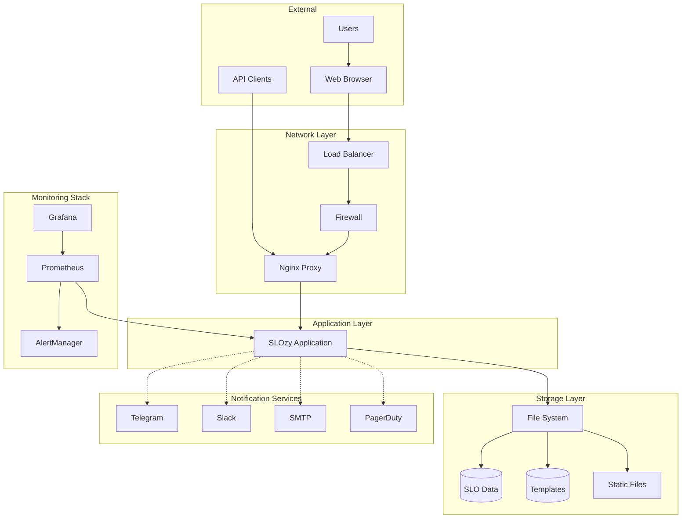
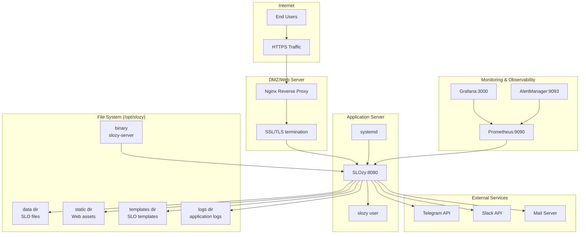
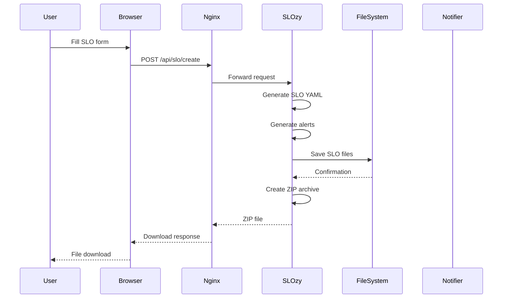
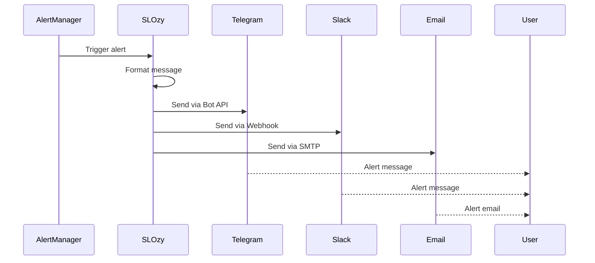

# SLOzy Architecture Documentation

## System Architecture

## Production Deployment Architecture

## Data Flow

### 1. SLO Creation Flow

### 2. Notification Flow

## Security Architecture

### Defense in Depth

1. **Network Layer**
   - Firewall rules limiting access to ports 80/443
   - Nginx as reverse proxy preventing direct access
   - Rate limiting at proxy level

2. **Application Layer**
   - Built-in rate limiting per endpoint
   - Input validation for all APIs
   - CORS restrictions
   - Security headers (HSTS, XSS Protection, etc.)

3. **System Layer**
   - Non-root user execution
   - File system restrictions
   - systemd namespace isolation (where supported)

4. **Data Layer**
   - File permissions (640 for config, 755 for directories)
   - Sensitive data in environment variables
   - No sensitive data in logs

## High Availability Considerations

While SLOzy is currently designed as a single-instance application, it can be made HA:

### Options for HA:

1. **Active-Passive with Failover**
   - Use keepalived or similar for VIP failover
   - Shared storage (NFS, S3) for SLO data
   - Service discovery via DNS updates

2. **Load Balanced Active-Active**
   - Requires architectural changes:
     - Database backend instead of file storage
     - Session affinity or stateless design
     - Distributed locking for template updates

3. **Container Orchestration**
   - Kubernetes deployment with persistent volumes
   - Horizontal pod autoscaling
   - Service mesh for traffic management

## Performance Characteristics

### Resource Utilization

| Metric | Expected Range | Scaling Impact |
|--------|----------------|----------------|
| CPU Usage | 5-15% @ 10 RPS | Linear |
| Memory | 50-100MB base | Minimal |
| Disk I/O | Low | Dependent on SLO creation |
| Network | ~1KB per request | Linear with response size |

### Bottlenecks

1. **SLO Creation Endpoint** - CPU intensive due to YAML generation
2. **Large Template Lists** - Memory usage scales with template count
3. **ZIP Generation** - Temporary disk space and CPU

### Optimization Strategies

1. **Caching**
   - HTTP caching for static assets (handled by Nginx)
   - In-memory caching for templates (future feature)

2. **Async Processing**
   - Background job processing for SLO generation (future feature)

3. **Connection Pooling**
   - Keep-alive connections for API clients

## Monitoring and Observability

### Key Metrics

1. **Application Metrics**
   - Request rate by endpoint
   - Response times (p50, p95, p99)
   - Error rates by status code
   - Active SLO count
   - Template count

2. **System Metrics**
   - CPU and memory usage
   - Disk usage and I/O
   - Network traffic
   - File descriptor usage

3. **Business Metrics**
   - SLOs created per hour/day
   - Most used templates
   - Notification delivery rates

### Alerting Strategy

1. **Service Health**
   - Service down
   - High error rates
   - High latency

2. **Resource Alerts**
   - Low memory
   - High CPU usage
   - Disk space running out

3. **Business Alerts**
   - No SLOs created in 24 hours (might indicate issues)

## Future Architecture Considerations

### V2.0 Architecture Planning

1. **Microservices Decomposition**
   - Separate API service from web UI
   - Dedicated notification service
   - Template management service

2. **Database Migration**
   - PostgreSQL for persistent storage
   - Redis for caching
   - Full-text search with Elasticsearch

3. **Cloud Native Features**
   - Kubernetes operators
   - Helm charts
   - Auto-scaling policies
   - Service mesh integration

4. **Advanced Features**
   - Multi-tenancy
   - RBAC (Role-based access control)
   - SAML/OAuth authentication
   - API versioning

### Migration Path

1. **Phase 1**: Add database backend alongside file storage
2. **Phase 2**: Implement data migration tool
3. **Phase 3**: Switch primary storage to database
4. **Phase 4**: Decommission file storage (but keep as export option)

## Integration Points

### Current Integrations

1. **Notification Channels**
   - Telegram Bot API
   - Slack Incoming Webhooks
   - SMTP email
   - PagerDuty API

2. **Monitoring Stack**
   - Prometheus metrics endpoint (`/metrics`)
   - Health check endpoint (`/health`)
   - Log output to journald

3. **File Output Formats**
   - OpenSLO YAML
   - Prometheus Alert Rules
   - AlertManager Configuration
   - Grafana Dashboard JSON

### Planned Integrations

1. **Authentication Providers**
   - SAML 2.0
   - OAuth 2.0 (Google, GitHub, etc.)
   - LDAP/Active Directory

2. **Storage Backends**
   - AWS S3
   - Git repositories
   - Confluence/SharePoint

3. **CI/CD Integrations**
   - Jenkins plugins
   - GitHub Actions
   - GitLab CI
   - Azure DevOps